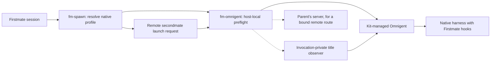
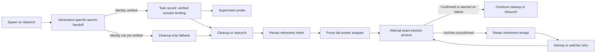
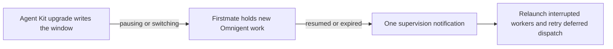
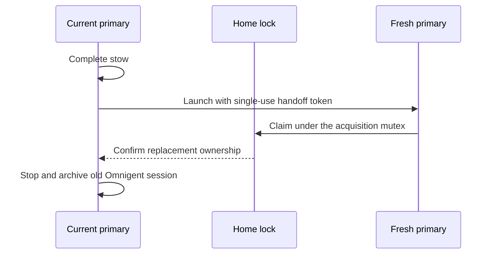
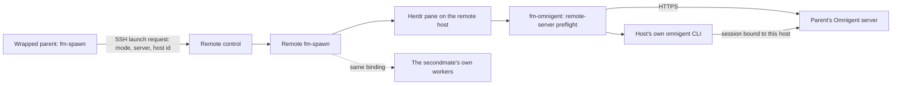

# Omnigent launch boundary

Firstmate selects and supervises the native harness; Omnigent owns the traced native session.
[Configuration](configuration.md#omnigent-launch-mode-configomnigent--fm_omnigent) owns enablement, setup, and supported limits.

`bin/fm-spawn.sh` resolves mode before endpoint creation and preserves the dispatched harness, model, and effort.
The launch template substitutes the Omnigent boundary for the native executable.
Native permission flags, prompts, busy hooks, and turn-end wiring retain their existing owners.
Quota dispatch continues to use the native harness identity.

`bin/fm-omnigent.sh` queries local Kit status and readiness during spawn preflight for launches without a [remote binding](#remote-host-launches).
Claude launches run one preflight with the selected account before endpoint launch; a control relaunch shares that check with spawn and retains the account refusal before stopping the old worker.
Ordinary worker panes reuse the spawn preflight result under the handoff contract in [`bin/fm-omnigent.sh`'s header](../bin/fm-omnigent.sh).
Secondmates, primary `start`, and launches without a handoff keep an independent full preflight.
Control relaunches without a generation-bound result also retain the independent pane preflight.
For Kit-managed launches, normal status supplies the running service coordinates; readiness selects the active runtime executable, including after activation or rollback.
The launcher accepts the retained headless runtime when readiness reports only `serve_setup_headless_only`, `serve_web_assets_missing`, or both.
The reports must agree on a running service and its server URL.
The selected executable must be a regular executable file beneath the status file's parent directory, with no symlink from that directory through the executable.
Kit-managed launches never select a separate Omnigent executable from `PATH`, because that executable can be stale.
Full preflight caches native `--env` and Claude account-enforcement capability flags per harness and executable identity; the handoff carries those verified flags to the pane.
Server health is checked on every launch; service selection and account lookup remain fresh for every full preflight.
`bin/fm-omnigent.sh`'s header owns the cache identity and dry-run contract.
A failure never executes the original native command as a fallback.
Preflight records stage timing and bounds the combined external-command wait.
Readiness and the capability check can use the remaining shared budget instead of a fixed stage allowance.
Slow or failed stages report timing on stderr; `bin/fm-omnigent.sh`'s header owns the stage limits and timing-log interface.
The increased status allowance mitigates transient timeouts; it does not establish why a status probe was slow or relax service identity checks.

## Session titles

The top-level primary title is `firstmate`.
An ordinary worker title is `<home> · <task>`; a persistent secondmate primary title is `<secondmate-home> · firstmate`.
The home label is the launch home's final path component.
`fm-spawn.sh` supplies the dispatched home and task explicitly, including when the backend daemon does not inherit the supervisor's environment.

`fm-omnigent-title.py` relays this invocation's diagnostic stderr and considers only its first `Web UI` session record.
If that record is malformed or names another server, naming stops without a session API request.
The native wrapper remains the foreground process and owns terminal attach, stdin, stdout, signals, and exit status.
The observer never reads the terminal display or chooses a session from a shared list.
`fm-omnigent.sh` reads the exact session through the supported API, verifies its ID, wrapper label, and creation time against this launch, then sends `PATCH /v1/sessions/<id>` with the requested title.
Record waiting, response size, and API requests are bounded; the launcher header owns the exact mechanics.
A loaded server can answer slowly, so the naming requests retry with backoff inside one bounded naming budget.
Naming errors appear on stderr without interrupting the native terminal or changing its exit status.
For a spawned worker, a naming failure also appends one `omnigent-unnamed:` event to the task's status log, so supervision sees the unnamed session at launch.
The observer handles the initial launch's title and worker session binding; it does not rename resumed sessions or later conversations created inside the native harness.
[Verification](verification/omnigent.md#launch-title-verification) distinguishes deterministic coverage from real-wrapper proof.

## Worker session lifecycle

Takeaway: retirement proves the old worker stopped before archiving history or releasing its worktree lease.

A spawn or relaunch passes its task record, spawn generation, home identity, and task id to the launcher.
Before the session identity read, the launcher publishes this launch's own `Web UI` session as an unverified fallback in a generation-specific handoff.
After the identity check succeeds, the launcher replaces that handoff with a verified binding before waiting for the task record lock.
For a bound remote launch, the handoff carries the recorded parent-server binding so retirement can validate the HTTPS session without an inherited environment.
The launcher then records `omnigent_session` and `omnigent_server` in that task record under the record lock.
Retirement reads either handoff under that lock before stopping the attach client or closing the endpoint.
An unverified handoff becomes `omnigent_unnamed` in the task record, so retirement need not wait for naming retries to finish.
A missing handoff produces a bounded warning; cleanup still requires the native-owner verdict described below.
The launcher or locked capture can record a verified identity only while the task record still names the launching spawn generation, including after a refused retirement.
Retirement intent remains durable under that record lock; delayed identity recovery neither clears it nor authorizes archive or lease release without stop proof.
An unverified fallback cannot be added after retirement, and a removed or superseded task record cannot accept the old generation's verified identity.
The late observer never archives a session on its own.
The same naming request sets `firstmate.home` to the full home-identity hash and `firstmate.task` to the task id; Omnigent merges labels rather than replacing them.
A relaunch drops the previous binding and unnamed fallback from the replacement record.

Cleanup and relaunch persist retirement intent, prove the old worker stopped, then attempt to archive its exact recorded session before closing the endpoint, releasing its worktree lease, or launching a replacement.
Forced secondmate cleanup does the same for each local descendant before removing its record, and automatic local secondmate recovery captures the handoff before closing the old endpoint.
Archive is a `PATCH` of `{"archived": true}` for the exact session identified by the binding or verified fallback.
If the identity read never answered, the launcher keeps this launch's own `Web UI` session as `omnigent_unnamed` in the task record instead of a binding.
Archive then reads that session and archives it only when the server reports the same session id, wrapper, and host, a creation time at or after the launch, and an offline runner.
A session whose identity read refuted the launch is never kept, and an unnamed session is never used for supervision probes.
The launch's own stderr record is the fallback source rather than a search of the server's session list, because an unnamed session has no Firstmate labels that could prove its home.
Firstmate never sends `delete_worktree`, because the session workspace is a shared worktree slot.
The archive flag can commit before the runner stops; archive confirmation is history retirement and never stop proof.
If stop evidence is unknown, cleanup and relaunch preserve the endpoint, record, and worktree lease.
Before cleanup removes a binding or relaunch replaces it, retirement saves its exact identity in a durable receipt.
After stop proof, an archive failure warns and does not block cleanup or relaunch; the receipt survives for a later retry.
Startup and watcher inactive reconciliation retry pending receipts within the existing home budget.
An unknown stop remains pending and visible, and confirmed archive removes the receipt.
If rolling back this implementation, preserve pending receipts until retry support is restored; never treat a timeout as stop proof.
The [retirement library header](../bin/fm-omnigent-retirement-lib.sh) owns the receipt format, matching rules, locks, and sweep limits.
If a dead session retains an attach client, exit signals only the recorded attach process group after checking its process start time and group ownership.
The daemon and other tasks remain outside that process group.
Relaunch waits for the attach client to stop before it reuses the endpoint.

The pane check reports attach-client state rather than native-worker state.
For an Omnigent-wrapped task, supervision readers consult the shared session snapshot even when the attach client has stopped or its endpoint is missing.
The watcher, crew-state reconciliation, and stale checks share one sanitized snapshot per task and launch binding.
Naming, lifecycle confirmation, and retirement share the same session refresh boundary as supervision.
The snapshot contains the session probe verdict and safe approval summaries; native hooks and local status files retain ownership of turn completion and busy state.
`runner_online` reports tunnel registration freshness rather than native-process liveness.
A successful session read proves reachability without a separate `/health` request.
An inconclusive session read remains unknown; server health cannot prove native-owner termination.
Slow or failed reads reduce the refresh rate through bounded backoff.
The [`bin/fm-omnigent.sh` header](../bin/fm-omnigent.sh) owns expiry, request limits, cache identity, and refresh mechanics.
Outside an explicit exit attempt, only a confirmed absent exact session reads as dead and permits recovery.
A disconnected runner, unreachable server, archived flag, failed turn, absent binding, or inconclusive session response reads as unknown.
An attach client that stops or disappears does not prove that its native owner stopped.
Unknown native-owner state withholds process-group signals, replacement, recovery, and teardown lease release; crew-state output reports the degradation.
Secondmate recovery readers require fresh session reads, including remote recovery probes.
Lifecycle commands require a fresh session read before stopping a retained attach client.
After Firstmate delivers an exit command, that exit attempt can also confirm termination when the attach client stops and fresh session and health reads prove the same session and generation is reachable with no active turn.
The shared exit implementation in `bin/fm-control-exit-lib.sh` scopes this confirmation to the exit attempt in control, teardown, or relaunch; supervision and independent recovery continue to require native absence.
Cached supervision verdicts never authorize that signal.

## Upgrade pause window

Takeaway: an Omnigent upgrade never receives new work mid-switch, and the workers it interrupted are named for relaunch afterwards.

The Agent Kit's Omnigent upgrade publishes a pause window at `${AGENT_KIT_OBSERVATION_DIR:-~/.agents/state/observation}/serve/upgrade-window.json`; the Kit owns its schema (personal-agent-kit ADR-0030).
While the window's phase is `pausing` or `switching` and its expiry is in the future, Firstmate starts no Omnigent-wrapped worker through that server and sends no new prompt to one:

- The initial spawn check defers before endpoint creation; `fm-control.sh relaunch` defers before stopping the old agent.
- The launcher checks again after preflight, so an in-flight spawn can leave a task record and endpoint while its Omnigent launch is deferred.
- Local inbox steers remain recorded while the watcher holds doorbells and retry bookkeeping until the window closes.
- Remote inbox steers remain recorded but require a caller retry after the window closes; the [`fm-send.sh` header](../bin/fm-send.sh) owns delivery status and safe resend mechanics.
- Typed-plane text is deferred without being sent.
- Running turns are never interrupted, and native launches are unaffected.

Launch and typed-send deferrals print `deferred:` and exit 75.
Automatic secondmate recovery checks the server owner's window before consuming a recovery attempt or changing the endpoint, including when the destination uses its own Kit service.
Firstmate does not write the optional acknowledgement; the Kit owns the bounded drain.
Remote bindings read the server owner's window through a bounded, noninteractive SSH read to the binding's hostname.
That host must be reachable through SSH with the current account; an unavailable read defers work with exit 75.
When the job resumes or its window expires, a home that deferred work for it or has eligible recovery tasks gets one `check: omnigent-upgrade` notification.
The notification names local workers whose recorded sessions were interrupted or are proven dead, plus local launches without a session binding whose endpoints are proven dead or missing.
Review-parked workers and remote secondmates are excluded; a missing binding alone does not establish death.
Supervision uses the notification to relaunch the named workers and retry deferred dispatch; the notification itself does not launch workers.
An unreadable window is ignored with a warning, because it carries no expiry that would bound the pause.
`bin/fm-upgrade-window-lib.sh` owns this reading.

## Fresh main sessions

The main Claude primary can use [`/fresh`](../.agents/skills/fresh/SKILL.md) to complete `/stow` and replace its long-running Omnigent session in one step.
The replacement starts in the same Firstmate home with the title `firstmate`.
Unlike `/clear`, this creates a new Omnigent session identity.
Workers, secondmates, and other primary harnesses are outside this command's scope.

The current primary retains charge until the replacement owns the lock.
`bin/fm-fresh-session.sh` owns the bounded handoff and recovery mechanics; its header and `--help` describe the exact command.
`bin/fm-lock.sh` validates the handoff token under its existing acquisition mutex before replacing a live owner.
An ordinary session without the token still cannot take over a live lock.
The launcher runs in a dedicated detached tmux session because the existing Omnigent CLI owns a foreground terminal attachment.
[Automatic Claude accounts](configuration.md#automatic-claude-accounts) owns selector forwarding, the running-service enforcement requirement, and the older-service limitation at the Omnigent boundary.
It uses the existing launcher and title observer, sends the old session a stop event that preserves its history, and then archives it.
A failed archive only warns; the completed handoff stands.
A startup failure preserves the old owner; a stop failure reports the replacement URL while preserving the new owner.
See [fresh-session handoff verification](verification/omnigent.md#fresh-session-handoff-verification) for regression coverage and live verification limits.

## Native environment and supervision

The service starts native terminals in a different process tree.
Shell inheritance into the CLI alone does not reach those terminals.
The launcher therefore sends the Firstmate-owned environment through Omnigent's explicit native `--env` interface, including `FM_BACKEND`, secondmate home isolation, and the inherited session mode.
It clears foreign harness markers and absent Firstmate routing variables, and leaves Omnigent's managed Codex home intact.
Git configuration passed through `GIT_CONFIG_COUNT` is forwarded as the complete counted set or not at all, because Git refuses to run when a counted entry is missing.
The launcher does not copy arbitrary ambient credentials.

Remote launch and recovery retain the existing SSH control boundary.
The parent sends its resolved mode for launch and relaunch, including secondmate restarts, and the destination resolves its own Kit service unless the route registers an [Omnigent binding](#remote-host-launches).
The remote endpoint reports its actual mode to the parent, alongside its native profile.
A recorded wrapped task remains wrapped through recovery.

On each pane poll, the watcher consults pending approvals through the shared session snapshot before applying busy or declared-wait suppression.
Approval detection follows snapshot expiry and the watcher's poll cadence; slow or failed reads extend the refresh interval through backoff.
An outstanding approval emits one actionable check wake per session and approval id, naming the task, endpoint, and a safe prompt heading.
The daemon routes this wake directly to escalation without stale-task or declared-wait classification.
Unrecognized prompt text uses a generic summary; command previews and tool arguments are never included.
`bin/fm-crew-state.sh` also reports the worker as parked while an approval is outstanding.
An unreachable or malformed session response supplies no approval verdict.
The watcher never answers approval prompts.

`bin/fm-agent-process-lib.sh` recognizes the observed Python interpreter, Omnigent entrypoint, and native subcommand in order.
A Python process merely mentioning Omnigent, or running its server, is not an agent.
The native harness remains the identity used by steering, interrupt, and exit.
A live wrapper alone does not prove that a model turn completed or that MLflow received its trace.
[Verification](verification/omnigent.md) separates those claims.

## Remote host launches

A remote second mate's host, such as a Linux worker, may run no Kit service of its own.
Its Omnigent host daemon instead connects to the parent's Omnigent server, which lists it under `/v1/hosts`.
A route opts in by registering that binding: the server's HTTPS origin as the remote host reaches it, and the host's registered id.
[Remote second mates](remote-secondmates.md#omnigent-through-the-parents-server) owns the registry fields and setup steps.

Takeaway: the same two layers as a local launch, Herdr then Omnigent, run on the remote host; only the server they bind to is the parent's.

1. A wrapped parent sends the route's server and host id on the launch or relaunch request; a native parent sends neither.
2. The remote control accepts the binding only with Omnigent mode on and passes it to the host-local spawn as `FM_OMNIGENT_SERVER` and `FM_OMNIGENT_HOST`.
3. The spawn records the binding in the task record, so a recovery that arrives without a request keeps it.
4. Preflight uses the `omnigent` on the host's `PATH`, resolved to its real path, and the runtime Python beside it.
   That Python must report this host's Omnigent identity as exactly the registered id; a host name is never matched.
5. Preflight then checks the server's `/health` and requires `/v1/hosts/<id>` to report the host online.
6. Inside the remote host's Herdr pane, the launcher runs `omnigent <harness> --server <server>`, which starts a local runner bound to the parent's server.
   The session-title check also requires the new session to report that host id.
   An HTTPS server is accepted only when it is exactly the server this binding names; every other server must still be loopback.
7. The native terminal receives the binding, so the secondmate's own workers launch through the same server and host.

An unregistered, offline, or differently identified host, a missing executable, or a partial or malformed binding refuses the launch with the exact cause.
None of these refusals falls back to a native launch or to a local Kit.
The binding carries no credential.
With no Kit status to attest fork provenance, Claude account enforcement relies on the executable's own capability entry.
Routes without a binding, local launches, and native launches keep their existing behavior.
`bin/fm-omnigent.sh`'s header owns the exact variables, record fields, and `binding` lookup.

## Conversation banner and draft protection

Shared composer classification and selected-content extraction remove one trailing `Omnigent: http://127.0.0.1:<port>/c/<32 lowercase hex digits>` line and any blank rows after it before reading the native composer.
The port must contain only decimal digits.
A home launched through a [parent's server](#remote-host-launches) also removes that exact server's banner, `Omnigent: <server>/c/<id>`, as named by `FM_OMNIGENT_SERVER`.
Remote control restores the endpoint's recorded binding before shared composer operations, including send and lifecycle control, so requests with a cleared environment recognize the same banner.
ANSI styling and trailing terminal padding do not change the match; other hosts, malformed URLs, and nonfinal banner rows remain content.
A final exact-match line is treated as wrapper output even without separate wrapper identity.
This prevents the banner from making an empty composer appear to hold a draft.
Native draft selection remains owned by [`bin/fm-composer-lib.sh`](../bin/fm-composer-lib.sh), including its enclosing-composer safety boundary.
The [conversation-footer verification record](verification/omnigent.md#2026-10-12-conversation-footer) distinguishes regression coverage from live evidence.
