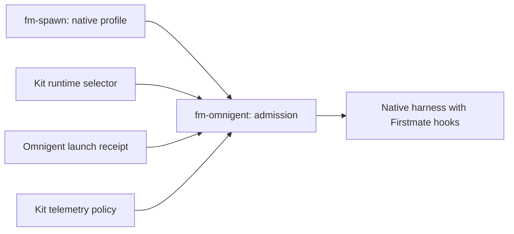

# Omnigent launch boundary

Firstmate admits a native launch from verified runtime and policy evidence; trace availability is a separate result.
[Configuration](configuration.md#omnigent-launch-mode-configomnigent--fm_omnigent) owns enablement, setup, and supported limits.

`bin/fm-spawn.sh` resolves mode before endpoint creation and preserves the dispatched harness, model, and effort.
The launch template substitutes the Omnigent boundary for the native executable.
Native permission flags, prompts, busy hooks, and turn-end wiring retain their existing owners.
Quota dispatch continues to use the native harness identity.

`bin/fm-omnigent.sh` queries the Kit runtime selector and telemetry policy for every preflight and again when the pane executes its launch.
The selector supplies the executable, full measured runtime identity, loopback endpoint, and exact client environment.
The launcher does not infer an executable from a state directory or use a separate Omnigent executable on `PATH`.
The selected executable must return a public launch receipt that matches the entire selected runtime identity and client environment.
The launcher verifies callable harness capabilities and the existing native `--env` interface.
The public receipt retains endpoint, authentication, runtime-generation, and environment refusals.
A failure never executes the original native command as a fallback.

The Kit owns telemetry policy, content capture, redaction, delivery, retry, and loss reporting.
Permitted admission continues during a trace gap and emits a separate degradation diagnostic.
Required collection denies new admission when collection is unavailable.
Excluded capture disables telemetry and removes export destinations from the attaching client and explicit native settings.
Enabled export uses only the policy's loopback redactor destination.
Unknown loss counters remain unknown; memory-only retry does not prove durable acceptance.
Telemetry checks have no authority to stop or replace an existing session.

The service starts native terminals in a different process tree.
Shell inheritance into the CLI alone does not reach those terminals.
The launcher therefore sends the Firstmate-owned environment through Omnigent's explicit native `--env` interface, including `FM_BACKEND`, secondmate home isolation, and the inherited session mode.
It clears foreign harness markers and absent Firstmate routing variables, and leaves Omnigent's managed Codex home intact.
The launcher does not copy arbitrary ambient credentials.

Remote launch and recovery retain the existing SSH control boundary.
The parent sends its resolved mode for launch and relaunch, including secondmate restarts, and the destination resolves its own Kit service.
The remote endpoint reports its actual mode to the parent, alongside its native profile.
A recorded wrapped task remains wrapped through recovery.

## Scoped recovery

1. Leave a running session and its durable inbox intact when telemetry reports a gap.
   Diagnose the collector or trace store through the Kit's component owner.
2. Before a new launch, run the read-only launcher `check` with the intended worker configuration and harness.
   The launcher's [help](../bin/fm-omnigent.sh) owns exact flags; its [receipt validator](../bin/fm-omnigent-contract.jq) owns consumer validation and safe refusal categories.
3. If runtime, endpoint, authentication, capability, or policy verification refuses, repair that owner before retrying admission.
   Do not substitute a binary on `PATH`, remove an account pin, or use a direct exporter as a workaround.
4. Use [`fm-control relaunch`](agent-control.md#transactional-relaunch) only for an explicitly requested replacement.
   Wrapped relaunch checks admission and worker restrictions before stopping the current agent.
   The launch checks again at pane execution; a later availability change can still refuse the replacement.

Explicit relaunch is a stop-and-replace transaction, not maintenance reattachment.
The launch receipt's custody capability does not identify a Firstmate task's existing native session.
Omnigent supports retained-runner custody for host-launched Codex sessions on macOS; Firstmate still needs the task/session binding and scoped adoption interface to consume it.
Firstmate has no supported maintenance-detach or native-adoption operation from the launch receipt alone.
Do not send lifecycle commands as steering text.
Same-session reattachment and duplicate-adoption refusal require an explicit session-owner contract and the separate mandatory acceptance in the [verification matrix](verification/omnigent.md#independent-launch-acceptance-matrix).

`bin/fm-agent-process-lib.sh` recognizes the observed Python interpreter, Omnigent entrypoint, and native subcommand in order.
A Python process merely mentioning Omnigent, or running its server, is not an agent.
The native harness remains the identity used by steering, interrupt, and exit.
A live wrapper alone does not prove that a model turn completed or that MLflow received its trace.
[Verification](verification/omnigent.md) separates those claims.

## Conversation banner and draft protection

Shared composer classification and selected-content extraction remove one trailing `Omnigent: http://127.0.0.1:<port>/c/<32 lowercase hex digits>` line and any blank rows after it before reading the native composer.
The port must contain only decimal digits.
ANSI styling and trailing terminal padding do not change the match; other hosts, malformed URLs, and nonfinal banner rows remain content.
A final exact-match line is treated as wrapper output even without separate wrapper identity.
This prevents the banner from making an empty composer appear to hold a draft.
Native draft selection remains owned by [`bin/fm-composer-lib.sh`](../bin/fm-composer-lib.sh), including its enclosing-composer safety boundary.
The [conversation-footer verification record](verification/omnigent.md#2026-10-12-conversation-footer) distinguishes regression coverage from live evidence.
