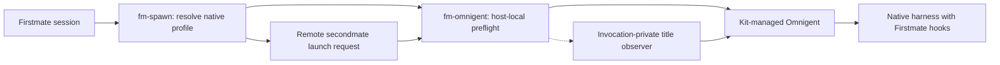

# Omnigent launch boundary

Firstmate selects and supervises the native harness; Omnigent owns the traced native session.
[Configuration](configuration.md#omnigent-launch-mode-configomnigent--fm_omnigent) owns enablement, setup, and supported limits.

`bin/fm-spawn.sh` resolves mode before endpoint creation and preserves the dispatched harness, model, and effort.
The launch template substitutes the Omnigent boundary for the native executable.
Native permission flags, prompts, busy hooks, and turn-end wiring retain their existing owners.
Quota dispatch continues to use the native harness identity.

`bin/fm-omnigent.sh` queries the local Kit status for every preflight and again when the pane executes its launch.
Normal status supplies the running service coordinates; readiness selects the active runtime executable, including after activation or rollback.
The launcher accepts the retained headless runtime when readiness reports only `serve_setup_headless_only`, `serve_web_assets_missing`, or both.
The reports must agree on a running service and its server URL.
The selected executable must be a regular executable file beneath the status file's parent directory, with no symlink from that directory through the executable.
A separate Omnigent executable on `PATH` can be stale.
The launcher checks the native `--env` capability and server health before invoking that runtime.
A failure never executes the original native command as a fallback.

## Session titles

The top-level primary title is `firstmate`.
An ordinary worker title is `<home> · <task>`; a persistent secondmate primary title is `<secondmate-home> · firstmate`.
The home label is the launch home's final path component.
`fm-spawn.sh` supplies the dispatched home and task explicitly, including when the backend daemon does not inherit the supervisor's environment.

`fm-omnigent-title.py` relays this invocation's diagnostic stderr and considers only its first `Web UI` session record.
If that record is malformed or names another server, naming stops without a session API request.
The native wrapper remains the foreground process and owns terminal attach, stdin, stdout, signals, and exit status.
The observer never reads the terminal display or chooses a session from a shared list.
`fm-omnigent.sh` reads the exact session through the supported API, verifies its ID, wrapper label, and creation time against this launch, then sends `PATCH /v1/sessions/<id>` with the requested title.
Record waiting, response size, and API requests are bounded; the launcher header owns the exact mechanics.
Naming errors appear on stderr without interrupting the native terminal or changing its exit status.
The observer handles launch titles only; it does not rename resumed sessions or later conversations created inside the native harness.
[Verification](verification/omnigent.md#launch-title-verification) distinguishes deterministic coverage from real-wrapper proof.

## Native environment and supervision

The service starts native terminals in a different process tree.
Shell inheritance into the CLI alone does not reach those terminals.
The launcher therefore sends the Firstmate-owned environment through Omnigent's explicit native `--env` interface, including `FM_BACKEND`, secondmate home isolation, and the inherited session mode.
It clears foreign harness markers and absent Firstmate routing variables, and leaves Omnigent's managed Codex home intact.
The launcher does not copy arbitrary ambient credentials.

Remote launch and recovery retain the existing SSH control boundary.
The parent sends its resolved mode for launch and relaunch, including secondmate restarts, and the destination resolves its own Kit service.
The remote endpoint reports its actual mode to the parent, alongside its native profile.
A recorded wrapped task remains wrapped through recovery.

`bin/fm-agent-process-lib.sh` recognizes the observed Python interpreter, Omnigent entrypoint, and native subcommand in order.
A Python process merely mentioning Omnigent, or running its server, is not an agent.
The native harness remains the identity used by steering, interrupt, and exit.
A live wrapper alone does not prove that a model turn completed or that MLflow received its trace.
[Verification](verification/omnigent.md) separates those claims.

## Conversation banner and draft protection

Shared composer classification and selected-content extraction remove one trailing `Omnigent: http://127.0.0.1:<port>/c/<32 lowercase hex digits>` line and any blank rows after it before reading the native composer.
The port must contain only decimal digits.
ANSI styling and trailing terminal padding do not change the match; other hosts, malformed URLs, and nonfinal banner rows remain content.
A final exact-match line is treated as wrapper output even without separate wrapper identity.
This prevents the banner from making an empty composer appear to hold a draft.
Native draft selection remains owned by [`bin/fm-composer-lib.sh`](../bin/fm-composer-lib.sh), including its enclosing-composer safety boundary.
The [conversation-footer verification record](verification/omnigent.md#2026-10-12-conversation-footer) distinguishes regression coverage from live evidence.
