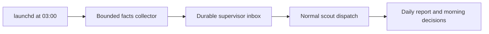

# Nightly velocity audit

The nightly audit collects retained evidence for the last 24 hours and requests one scout to propose improvements.
The collector runs as a standalone process outside Omnigent.
The scout proposes fixes for explicit yes/no decisions; the audit never applies them.



The supervisor owns scout dispatch and report delivery, so the scheduled process does not bypass account, quota, isolation, or session-lock checks.
When firstmate is offline, the request waits durably for its next session.
This is a dispatch request, not a guarantee that a model starts at 03:00.

## Run once

From an initialized Firstmate home, run the entry point from the installed code root:

```sh
FM_HOME=/absolute/firstmate-home /absolute/firstmate-code/bin/fm-velocity-nightly.sh --dry-run
FM_HOME=/absolute/firstmate-home /absolute/firstmate-code/bin/fm-velocity-nightly.sh
```

The first command previews the facts and inbox destinations.
The second collects facts and queues the scout request through [`fm-inbox.sh`](../bin/fm-inbox.sh).
Firstmate must process that inbox request through its normal intake and [`fm-spawn.sh --scout`](../bin/fm-spawn.sh) path.
The request specifies the report scope and requires a check for an existing daily task before dispatch.
No alternate scheduler or worker launcher is introduced.

The snapshot lives at `data/velocity-audit/<UTC-end-date>/facts.json`.
The scout writes its normal task report and a daily copy at `data/velocity-audit/<UTC-end-date>/report.md`.
The supervisor surfaces the report and its pending yes/no proposals through the existing scout-completion and captain-hold paths for the morning summary.
There are at most three findings, each with supporting evidence, a likely cause and confidence, and one concrete proposed fix.
Insufficient evidence produces fewer findings and a stated gap.

Retries preserve the original daily snapshot and use the inbox's stable request identity.
A saved-but-unannounced inbox note returns exit 3; use the repair command reported by the inbox rather than a new request identity.
Scripts report failures to stderr and return nonzero.
The daily request does not recur automatically unless the operator installs the schedule.

## Install the optional macOS schedule

[`velocity-audit.plist`](examples/velocity-audit.plist) is a template, not an installed job.
Installation is a separate operator action after the change has landed.

1. Copy the template to `~/Library/LaunchAgents/dev.firstmate.velocity-audit.plist`.
2. Replace `__FIRSTMATE_ROOT__`, `__FM_HOME__`, and `__HOME__` with absolute paths, using XML escaping when necessary.
   Use the installed code root rather than a disposable task worktree.
3. Ensure the selected home's `state/` exists and the template's `PATH` resolves `python3`, `jq`, and authenticated `gh-axi`.
   The collector needs no model credentials; normal supervisor intake owns the scout's credentials.
4. Run `plutil -lint` on the copied file, then load it with `launchctl bootstrap gui/$(id -u) <copied-plist-path>`.
5. Run the entry point once now and confirm the facts file and pending inbox note.
   Confirm the scout report after firstmate processes the request.

The template requests 03:00 in the Mac's local timezone, with no RunAtLoad or KeepAlive loop.
The snapshot's date label is UTC and its actual half-open window is recorded in epoch seconds.
Sleep and login availability can delay execution; this is not a missed-day backfill scheduler.
The stdout and stderr files under `state/velocity-audit-launchd.*.log` expose job failures.
Disable the job with `launchctl bootout gui/$(id -u) <copied-plist-path>` before removing its installed plist.

## Evidence and limits

[`fm-velocity-facts.py`](../bin/fm-velocity-facts.py) owns the JSON schema, source list, bounds, and missing-data behavior.
[`fm-velocity-facts.sh --help`](../bin/fm-velocity-facts.sh) and [`fm-velocity-nightly.sh --help`](../bin/fm-velocity-nightly.sh) own command syntax.
The collector reads only the selected home; it does not traverse projects, secondmate homes, or model-session transcripts.
It leaves source records unchanged and publishes canonical JSON without replacing existing facts.
Live GitHub timestamps are optional for the standalone collector and enabled by the nightly entry point, using bounded `gh-axi` calls for recorded PR URLs.
An unavailable forge remains explicit and does not prevent local evidence collection.

| Evidence | Meaning and limitation |
| --- | --- |
| Status/meta timelines | Retained declarations in the window, with a preceding event for context; teardown can remove records. |
| Backlog rows | Dated rows from the Markdown backlog and archive; day precision, not an exact transition journal or another adapter's history. |
| Wake counts | Pending rows stamped in the window, grouped by type; acknowledged wakes are absent. |
| Triage counts | Retained timestamped triage entries in the window, grouped by event text. |
| Notification counts | Retained delivery records by type; delivery timestamps are unavailable, so `count_24h` is null. |
| PR timestamps | Available open/merge timestamps for recorded GitHub URLs; not discovery of all repositories or historical PRs. |

The report must keep observations, inferred causes, and missing telemetry separate.
These records support proposals; they cannot prove total coding time or complete daily throughput.
The collector fails on unsafe paths, malformed structured records, and hard inventory/output limits.
Log tails disclose omitted prefixes, and optional missing sources appear in `limitations`.

## Verify

Run `bin/fm-test-run.sh tests/fm-velocity-facts.test.sh` for isolated collector and nightly inbox coverage.
The suite uses temporary homes and exercises window boundaries, supported correlation-token status records, optional forge enrichment, bounded logs, retry behavior, unsafe paths, and dry-run isolation.
